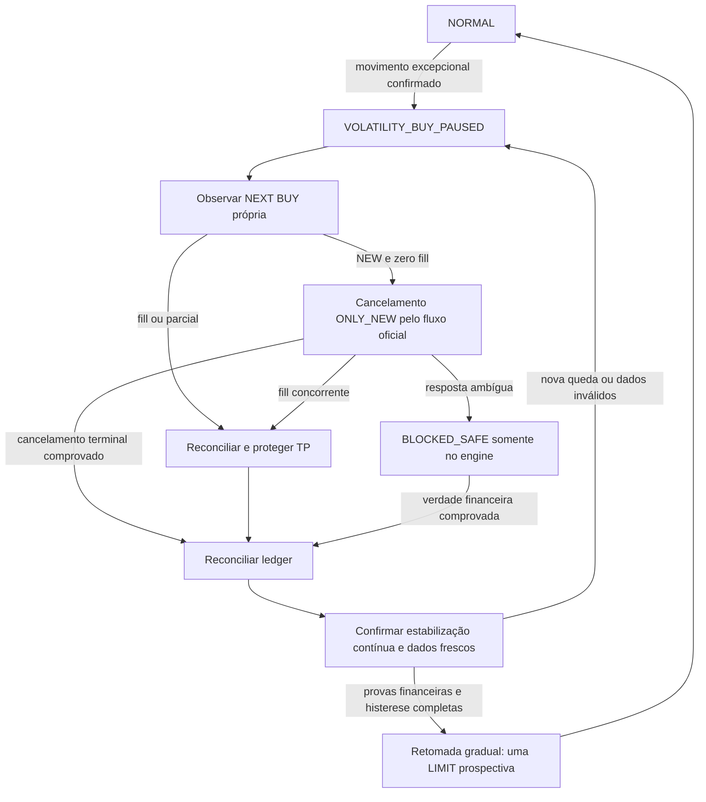

# Auditoria de entradas e certificação de proteção de execução

## Decisão desta revisão

A proteção candidata permanece **DESATIVADA e fora do grafo LIVE**. O protótipo
em `tools/research/execution-crash-20261105` produz apenas estados e intenções
offline; não possui transporte, configuração produtiva, migration ou cron.
Seu certificado documenta os testes e os gates reprovados. Não existe uma
proteção LIVE implicitamente habilitada por este documento.

A auditoria operacional usa o projeto OnPlay Platform
`otdfpmsegjxpqrzisfmi`, schema `coinops`, ambiente REAL. Evidências com contas,
IDs de ordens e dados financeiros permanecem locais em `docs/evidence`, sem
credenciais e fora desta publicação. As leituras usam a CLI oficial e os IPs
dos executores registrados; nenhum trade serve como teste.

## Semântica que a auditoria deve preservar

- Spacing pertence ao motor e ao snapshot da decisão. Comparar a geometria do
  nível com sua âncora e regime; não substituir o snapshot por defaults atuais.
- Distinguir preço planejado, LIMIT submetida e média ponderada dos fills. Uma
  LIMIT pode obter preço melhor; isso não prova reancoragem ou duplicação.
- Reentrada local, grids históricos com âncoras diferentes e recuperação
  `PRIORITY_MISSED_MARKET_V1` podem produzir fills próximos. O spacing atual
  não define uma distância mínima universal entre todas as posições abertas.
- Uma BUY residente por engine não impede várias entradas legítimas em ciclos
  sucessivos. O planner atual não faz catch-up em lote na mesma invocação, mas
  pode recuperar outro nível atravessado no próximo ciclo. Locks e idempotência
  protegem contra duplicação; não são um cooldown entre decisões distintas.
- TP canônico = `ceil_tick(média efetiva de entrada × (1 + gain))`. Gain é alvo
  **bruto de preço**. Taxas de entrada/saída e arredondamento reduzem o líquido.
  A taxa futura de saída não é um fato confirmado antes de seu fill.
- BUY MARKET por quote tem `requested_quantity = null`. Conferir o orçamento
  original contra `origQuoteOrderQty`, além de fills, sem comparar null com
  `origQty` como se fosse uma LIMIT.
- Snapshots podem conservar um `market_entry_intent` anterior. Usá-lo somente
  em uma MARKET com engine/run/slot/operação exatos. Uma LIMIT posterior não
  herda a referência de outra operação para fins de auditoria.
- Duas BUYs na mesma operação só qualificam como recuperação parcial quando
  autorização, evento imutável, fonte, ownership e complemento próprio estiverem
  comprovados. Não confundir esse caso explícito com duas decisões duplicadas.

## Fronteira obrigatória para uma proteção futura

Estado persistido próprio por engine, distinto de pausa manual, erro financeiro
e kill switch. O gate precisa cobrir preparação e dispatch de INITIAL, LIMIT,
MARKET e ordens PREPARED, sob a lease e o fencing canônicos. OPEN, TP, ledger,
gains, metas, capital e parâmetros individuais permanecem intactos.

Uma parcial abaixo do mínimo de TP não deve perder o restante de sua BUY por
uma pausa automática. O worker normal possui esse guard. `pauseLiveRun`
representa uma ação manual com outro contrato e não deve ser reutilizado como
atalho para um detector automático.

Retomada exige atualizar atomicamente somente níveis futuros não comprometidos,
com proveniência e prioridade cumulativa preservadas. Cancelar uma BUY, aguardar
um relógio e simplesmente reabrir o motor liberaria novamente a fila de níveis
atravessados. Não executar esse backlog por MARKET para capturar o fundo.

## Gates de certificação

1. Dados fechados, frescos, sem look-ahead; velocidade, amplitude e volatilidade
   próprias do mercado. Ausência de liquidez histórica é uma lacuna explícita.
2. Determinismo, idempotência, isolamento, cancel/fill parcial e ambíguo, crash,
   retomada e todos os caminhos financeiros testados com o worker real isolado.
3. Persistência/RLS, lease/CAS/fencing e replanejamento anti-backlog comprovados.
4. Comparação econômica com capital/spacing/gain/custos iguais e cenários
   negativos publicados. Menos compras ou mais gains isoladamente não aprovam.
5. Integração com Watchdog e relatórios sem classificar pausa de volatilidade
   como falha de infraestrutura nem esconder incidentes financeiros verdadeiros.

Os replays publicados são um benchmark simplificado, não uma reprodução completa
da Strategy Engine com ATH, metas acumulativas e filtros históricos. As falhas
econômicas do benchmark e as lacunas de integração impedem ativação. Não usar
seus retornos como previsão de resultado das contas.

## Validação desta entrega

Atualizou-se a fixture do worker de proteção/pausa para importar os helpers
canônicos atuais. Incluíram-se regressões de parcial pequena residente e pausa
manual de parcial já protegível, preservando TPs e irmãos. Nenhuma regra de
trading foi alterada. O fingerprint financeiro e o runtime nativo permanecem os
da release anterior. Ver comandos e resultados do protótipo em seu README e
`certification.json`.
